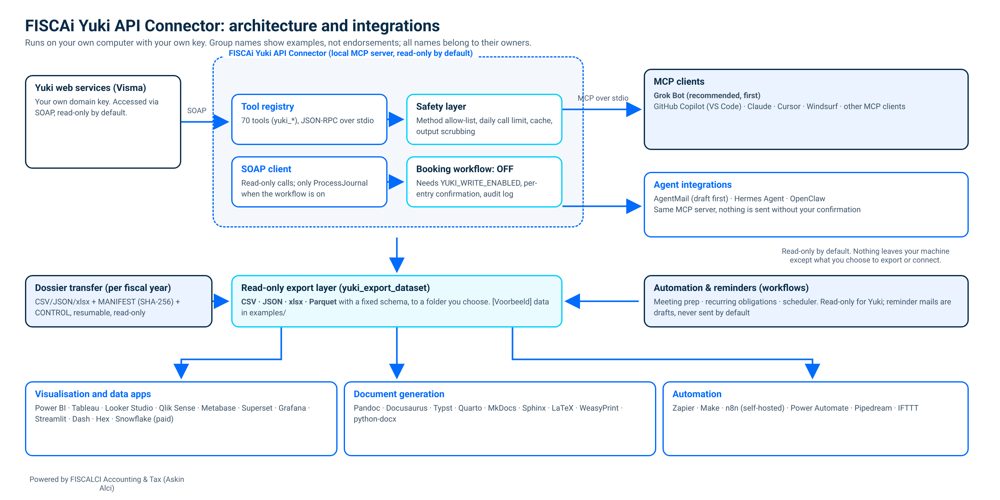
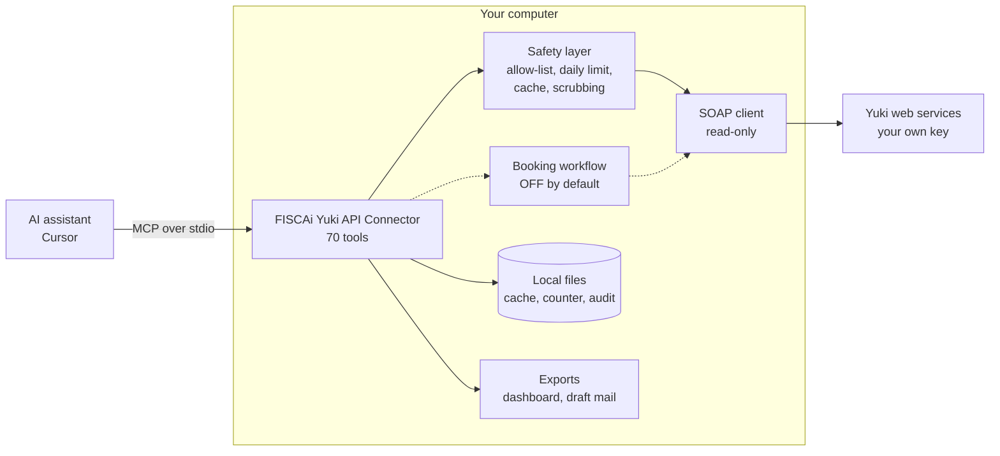
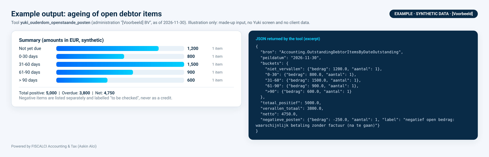

<p align="center">
  
</p>

<h1 align="center">FISCAi Yuki API Connector <br><sub>Plugin for Grok Bot, also works in Copilot, Claude, Cursor, Windsurf and other MCP clients</sub></h1>

<p align="center"><b>The Yuki (Visma) plugin for Grok Bot: read-only by default, running locally with your own key.</b></p>

<p align="center">
  
  
  
  
</p>

<p align="center"><a href="README.nl.md">Nederlands</a> &middot; <a href="docs/index.md">Docs</a> &middot; <a href="CHANGELOG.md">Changelog</a></p>

Powered by FISCALCI Accounting & Tax (Askin Alci)

Author: Askin Alci

> **Belgium.** Made for Belgian accountants and bookkeepers: it follows the Belgian chart of accounts (MAR) and Belgian VAT. Outside Belgium, check the local rules yourself.

**Nederlandse samenvatting.** Bedoeld voor Belgische boekhouders/accountants; gebaseerd op Belgische boekhoud- en btw-regels (MAR, Belgisch btw-stelsel). Gebruik buiten België: verifieer zelf de lokale regels. Zie [README.nl.md](README.nl.md) voor de volledige Nederlandse uitleg.

## Contents

[What it does](#what-it-does) · [How it works](#how-it-works) · [Example output](#example-output) · [Install in Grok Bot](#install-in-grok-bot-recommended) · [Other MCP clients](#other-mcp-clients-cursor-claude-copilot-windsurf) · [Configuration](#configuration) · [Security and safety](#security-and-safety) · [Tools](#tools) · [Limitations](#limitations) · [FAQ](#faq) · [License](#license)


**Agents.** [Ready-made agent definitions](agents/README.md) for Grok Bot, Claude, GitHub Copilot, Cursor, OpenAI Agents SDK and open models; see also [AGENTS.md](AGENTS.md).


**Command line and hooks.** [CLI reference](docs/CLI.md) (`yuki-api-connector doctor | tools | call | export | dashboard | serve`) and [Hooks](docs/HOOKS.md) (off by default, no secrets).


**Postman.** [Collection for the read calls](docs/POSTMAN.md) (file-based, complementary to the [official Yuki Postman documentation](https://documenter.getpostman.com/view/12207912/UVCBB51L); not an official Yuki or Visma product).


**Project health.** [Troubleshooting and FAQ](docs/TROUBLESHOOTING.md) · [Privacy and data flow](docs/PRIVACY-DATA-FLOW.md) · [Errors, logging, timeouts and limits](docs/OPERATIONS.md) · [Roadmap](ROADMAP.md) · [Code of conduct](CODE_OF_CONDUCT.md) · [Security](SECURITY.md)

## What it does

**FISCAi Yuki API Connector is first and foremost a plugin for Grok Bot.** It is a local [MCP](https://modelcontextprotocol.io) server (stdio), bundled with a Grok Bot-ready skill, that lets Grok Bot read your Yuki administrations: balances, ledger entries, open debtor and creditor items, VAT returns, contacts and archive metadata. On top of the raw data it adds deterministic analyses and drafts, always with the Yuki method used as the source.

- **70 tools**, all read-only unless you switch on the optional booking workflow.
- **Analyses:** ageing of open items (not yet due, 0-30, 31-60, 61-90, over 90 days), DSO/DPO, top relations, period comparison, margin and cost structure, liquidity ratios, outliers in the ledger.
- **Dashboard** as an MCP app widget and as a static HTML export to a folder you choose.
- **Draft reminder emails** (text, HTML, optional `.eml`) for open items. The plugin contains no mail or network-send code and never sends anything.
- **Guidance** on positive and negative balances, and **matching proposals** for negative open items (proposals only).
- **Made for Grok Bot,** usable from other MCP clients (Cursor, Claude, Copilot, Windsurf ...).
- **Your own key, your own computer:** no central server, no shared cache, no data to third parties.

## How it works





## Example output



*Illustration with made-up `[Voorbeeld]` data, rendered from the real function output. It is not a Yuki screen and contains no client data.*

## Install in Grok Bot (recommended)

This repository is a Grok Bot plugin: it contains the plugin manifest (`plugin.json`, `.cursor-plugin/plugin.json`), the MCP server definition (`mcp.json`), and a skill (`skills/fiscai-yuki-api-connector/SKILL.md`) that tells Grok Bot when and how to use the tools.

1. Requirements: Python 3.10 or higher and a Yuki API key (portal key or domain key).
2. Get the code and install the two free dependencies:
   ```bash
   git clone <repository-url> fiscai-yuki-api-connector
   cd fiscai-yuki-api-connector
   python3 -m venv .venv
   .venv/bin/pip install -r requirements.txt   # httpx and cryptography
   ```
3. Add the folder to Grok Bot as a plugin (from the repository or from the local folder) and fill in the variables it asks for. At minimum: `YUKI_ACCESS_KEY`. Enter the key in Grok Bot's own settings; never put it in a file or in the chat. The exact menu names depend on your Grok Bot version.
4. Ask Grok Bot: "Run `yuki_status`". It makes no Yuki call and confirms the setup. Then try: "Give me the ageing of the debtors of [Voorbeeld] as of 30/11/2026."

Grok Bot keeps writing to Yuki off: the optional booking workflow stays disabled unless you set `YUKI_WRITE_ENABLED=ja` yourself.

## Quickstart (command line)

After the install steps above (about five minutes if Python 3.10+ is present; not timed):

```bash
export YUKI_ACCESS_KEY=...            # your own key; never commit it (or: yuki-api-connector config init)
yuki-api-connector doctor             # checks Python, packages and variables; prints no secrets
yuki-api-connector tools --names-only
yuki-api-connector call yuki_administraties --json
yuki-api-connector dashboard --administratie "[Voorbeeld] BV" --jaar 2026 --dry-run   # drop --dry-run for a real call
```

Without installing the package use `python3 server/run_connector.py ...`. Full reference: [docs/CLI.md](docs/CLI.md).

**Automation and reminders.** [Meeting preparation and recurring obligations](docs/AUTOMATION.md) (`yuki-api-connector workflows plan | run | list`): overviews you define, draft reminder e-mails, never sent by default; read-only for Yuki.

**Manuals and dossier transfer.** [Complete manual (EN)](docs/manuals/manual.en.md) · [Volledige handleiding (NL)](docs/manuals/handleiding.nl.md) (printable PDF and DOCX in `docs/manuals/`) · [Dossier transfer per fiscal year](docs/DOSSIER-TRANSFER.md) (`yuki-api-connector transfer export`).

## Other MCP clients (Cursor, Claude, Copilot, Windsurf ...)

The server speaks the standard MCP protocol over stdio, so other MCP clients can use it too. Setup differs per client. Example for Cursor (`~/.cursor/mcp.json` or `.cursor/mcp.json` in a project): use the absolute path of your checkout and let the client read the key from your environment; never paste a key into a file:

```json
{
  "mcpServers": {
    "fiscai-yuki-api-connector": {
      "command": "/absolute/path/to/fiscai-yuki-api-connector/.venv/bin/python",
      "args": ["/absolute/path/to/fiscai-yuki-api-connector/server/run_server.py"],
      "env": {
        "YUKI_ACCESS_KEY": "${env:YUKI_ACCESS_KEY}",
        "YUKI_ACCESS_LEVEL": "portaal"
      }
    }
  }
}
```

The same command, arguments and environment variables apply in Claude, Copilot, Windsurf and other clients; use that client's own syntax for MCP servers. The bundled skill is written for Grok Bot; other clients simply use the tool descriptions.

## Compatibility and guides

| Client or platform | Role | Guide | Verified |
|---|---|---|---|
| **Grok Bot** | recommended: plugin + skill | [docs/clients/grok-bot.md](docs/clients/grok-bot.md) | primary target |
| Cursor | MCP client | [docs/clients/cursor.md](docs/clients/cursor.md) | config format checked in official docs |
| Claude Desktop | MCP client | [docs/clients/claude-desktop.md](docs/clients/claude-desktop.md) | config format checked in official docs |
| Claude Code | MCP client | [docs/clients/claude-code.md](docs/clients/claude-code.md) | config format checked in official docs |
| GitHub Copilot (VS Code) | MCP client | [docs/clients/github-copilot-vscode.md](docs/clients/github-copilot-vscode.md) | config format checked in official docs |
| Windsurf | MCP client | [docs/clients/windsurf.md](docs/clients/windsurf.md) | verify current client docs |
| Any MCP client | stdio | [docs/clients/generic-mcp-client.md](docs/clients/generic-mcp-client.md) | standard MCP |
| Hermes Agent (Nous Research) | agent with native MCP | [docs/integrations/hermes.md](docs/integrations/hermes.md) | checked in official docs |
| OpenClaw | agent gateway with MCP registry | [docs/integrations/openclaw.md](docs/integrations/openclaw.md) | checked in official docs |
| AgentMail | companion server for mail drafts | [docs/integrations/agentmail.md](docs/integrations/agentmail.md) | checked in official docs |

Configs were checked against each project's official documentation on 2026-11-20 and not tested live in every client. All examples are in [`examples/`](examples/) and use placeholders for keys.

**For business owners.** Read your own Yuki administration and build a dashboard: [docs/business-owners](docs/business-owners/README.md). Read-only, with `yuki_dashboard_kpis`.

**For accountants (portal key).** Portfolio overview across files: [docs/accountants-portal](docs/accountants-portal/README.md), with `yuki_portfolio_kpis`.

**More integrations.** [Visualisation and data apps](docs/integrations/visualisatie/README.md) (Power BI, Qlik Sense, Domo, Looker Studio, Tableau, Lovable, Metabase, Superset, Grafana, Streamlit, Dash, Hex, Snowflake) on one [export schema](docs/EXPORT-SCHEMA.md) (`yuki_export_dataset`: CSV, JSON, xlsx, Parquet) · [Document generation](docs/integrations/documenten/README.md) · [Data collection](docs/integrations/gegevensverzameling/README.md) · [Automation](docs/integrations/automatisering/README.md) · [40 useful apps](docs/integrations/APPS.md). Optional console command after `pip install .`: `fiscai-yuki-api-connector`.

## Configuration

All settings are environment variables. `YUKI_ACCESS_KEY` is the only required one.

| Variable | Meaning | Default |
|---|---|---|
| `YUKI_ACCESS_KEY` | Your Yuki access key (secret; alias `YUKI_API_KEY`). | required |
| `YUKI_ACCESS_LEVEL` | `portaal` (accountant-portal key, all administrations) or `domein` (key of one domain). | `portaal` |
| `YUKI_CACHE_KEY` | Optional strong secret for the local encrypted session cache. Without it a key is created once in the data folder (mode 0600). | automatic |
| `YUKI_DAILY_LIMIT` | Daily call limit per domain. Yuki: 1,000 calls per domain per day are free. | `900` |
| `YUKI_DAILY_LIMIT_APPROVAL` | Needed only above 1,000: your explicit confirmation (costs may follow). | empty |
| `YUKI_DOMAIN` | Domain label used to count calls that name no domain. | key-dependent |
| `YUKI_DATA_DIR` | Folder for cache, counter and audit log. | `~/.fiscai-yuki-api-connector` |
| `YUKI_CREDITOR_SIGN` | `positief` or `negatief`: sign of creditor items still to pay in your books (see the balance guide). | `positief` |
| `YUKI_WRITE_ENABLED` | `ja` switches on the optional booking workflow. Any other value or empty: writing is off. | off |
| `YUKI_WRITE_TOKEN_TTL_MIN` | Lifetime of a confirmation token in minutes (1 to 60). | `15` |
| `YUKI_WRITE_MAX_PER_DAY` | Maximum bookings per day (1 to 100). | `25` |
| `YUKI_BRAND_NAME`, `YUKI_BRAND_COLOR`, `YUKI_BRAND_LOGO_PATH` | Your own branding of dashboard and guide. | neutral |
| `YUKI_MAIL_SIGNATURE` | Text under the closing line of draft emails. | `[Handtekening]` |

Per-domain keys: `YUKI_ACCESS_KEY_<DOMAIN>` plus the `domein` parameter per call.

**Daily call limit.** Yuki includes 1,000 calls per domain per day for free. The plugin blocks hard at 900 per domain per day by default (`YUKI_DAILY_LIMIT`). Above 1,000 it needs your explicit confirmation and warns that costs may follow.

## Security and safety

- **Read-only by default.** Without `YUKI_WRITE_ENABLED=ja` no tool can book, upload or change anything in Yuki. All `Process*`, `Upload*`, `Update*` and `Set*` methods are refused, also by prefix.
- **Optional booking workflow, off by default.** When you switch it on, only `Accounting.ProcessJournal` is used, one journal entry per explicit confirmation: proposal first, a one-time token bound to the administration and the exact journal, a double-entry check, a daily maximum and an audit log. See [docs/BOEKINGSWORKFLOW.md](docs/BOEKINGSWORKFLOW.md).
- **Workflow documents are not booked as journal entries.** Purchase and sales invoices waiting in Yuki's back office are finished with the **Afhandelen** button in Yuki. The plugin refuses to turn such a document into a journal entry (that would double the cost) and offers `yuki_afhandeling_controle` to check afterwards, read-only, that the document left the workflow. To "book in Yuki" means: back-office status *Afgehandeld*.
- **Secrets stay in the environment.** Keys are never written to files, logs or tool output (output is scrubbed). Session cache and call counter are local, encrypted or mode 0600.
- **Exports only where you say.** Dashboards, guides and drafts are written to a folder you choose.
- **Mandatory attribution.** The text *Powered by FISCALCI Accounting & Tax (Askin Alci)* is checked at start-up and in every export, as required by `NOTICE`.

Please report vulnerabilities privately, see [SECURITY.md](SECURITY.md).

## Tools

| Group | Tools | Examples |
|---|---|---|
| Status and limits | 1 | `yuki_status` |
| Administrations and domains | 5 | `yuki_administraties`, `yuki_domeinen`, `yuki_bedrijven`, `yuki_huidig_domein`, ... |
| Balances and general ledger | 11 | `yuki_proefbalans`, `yuki_startbalans`, `yuki_periodetabel`, `yuki_boekjaar_gewijzigd`, ... |
| Open items | 3 | `yuki_openstaande_posten`, `yuki_openstaande_posten_periode`, `yuki_controleer_open_post` |
| Analyses | 7 | `yuki_ouderdom_openstaande_posten`, `yuki_dso_dpo`, `yuki_top_relaties`, `yuki_periodevergelijking`, ... |
| Dashboard, drafts and guidance | 6 | `yuki_dashboard`, `yuki_herinneringsmail`, `yuki_handleiding_saldi`, `yuki_afpuntingsvoorstellen`, ... |
| Key figures and export (read-only) | 4 | `yuki_dashboard_kpis`, `yuki_portfolio_kpis`, `yuki_export_dataset`, `yuki_dossier_transfer_export` |
| VAT, projects and master data | 7 | `yuki_btw_aangiftes`, `yuki_btw_codes`, `yuki_projecten`, `yuki_projectsaldo`, ... |
| Contacts | 2 | `yuki_contacten_zoeken`, `yuki_klanten_leveranciers` |
| Archive (metadata only) | 18 | `yuki_archief_mappen`, `yuki_archief_mappen_aantallen`, `yuki_archief_tabs`, `yuki_archief_documenten`, ... |
| Backoffice and optional booking workflow (writes OFF by default) | 6 | `yuki_backoffice_workflow`, `yuki_afhandeling_controle`, `yuki_boeking_voorstel`, `yuki_boeking_overslaan`, ... |

The complete list with descriptions is in [docs/TOOLS.md](docs/TOOLS.md). The Yuki methods that are allowed or deliberately excluded are in [docs/INVENTARIS-LEESMETHODES.md](docs/INVENTARIS-LEESMETHODES.md). Tool names and tool descriptions are in Dutch.

## Limitations

- Built for Belgium (MAR, Belgian VAT). Elsewhere, verify the local rules yourself; `yuki_rgs_schema` is a Dutch reference that is normally not used in Belgium.
- Archive tools return **metadata only**, never the files themselves.
- The Yuki API has no documented method to set an existing workflow document to *Afgehandeld*; that step stays with a person in Yuki.
- The optional booking workflow was tested with mocks and synthetic data only. Test it first in a test administration and let your accountant check the first entries.
- You need a Yuki API key; free call quota per domain per day applies.
- Not approved or endorsed by Yuki or Visma. Yuki is a trademark of its owner.

## FAQ

**Is this only for Grok Bot?** It is built as a Grok Bot plugin and that is the recommended route. Because it is a standard MCP stdio server it also works in other MCP clients; see the section above.

**Does it send data anywhere?** Only to the Yuki web services you already use, from your own computer with your own key. There is no server of ours in between.

**Can it change my bookkeeping?** Not unless you set `YUKI_WRITE_ENABLED=ja`, and then only one confirmed journal entry at a time. Workflow documents are always excluded.

**Does it send emails?** No. It builds a draft that you review and send yourself.

**Why do I see a daily limit?** To protect your Yuki quota. Raise or lower it with `YUKI_DAILY_LIMIT`; check `yuki_status` first for big tasks.

**Can I use it outside Belgium?** The read tools work with any Yuki administration, but the analyses and booking proposals assume the Belgian MAR and VAT. Check local rules.

**Can I run the tests?** Yes: `.venv/bin/python -m pytest -p no:cacheprovider -q tests`. They use mocks only and make no Yuki calls.

## License

Apache-2.0, see [LICENSE](LICENSE). The attribution in [NOTICE](NOTICE) must be kept. Contributions: see [CONTRIBUTING.md](CONTRIBUTING.md).

<!-- mcp-name: io.github.MnrAlci/fiscai-yuki-api-connector -->
