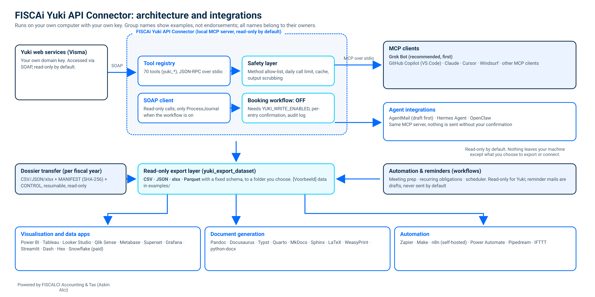
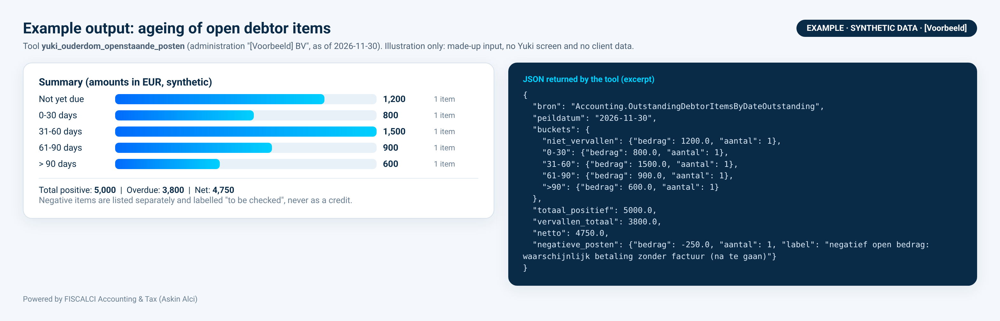

<p align="center">
  
</p>

<h1 align="center">FISCAi Yuki API Connector <br><sub>Plugin voor Grok Bot, werkt ook in Copilot, Claude, Cursor, Windsurf en andere MCP-clients</sub></h1>

<p align="center"><b>De Yuki-plugin (Visma) voor Grok Bot: standaard alleen-lezen, lokaal met uw eigen sleutel.</b></p>

<p align="center">
  
  
  
  
</p>

<p align="center"><a href="README.md">English</a> &middot; <a href="docs/index.md">Docs</a> &middot; <a href="CHANGELOG.md">Changelog</a></p>

Powered by FISCALCI Accounting & Tax (Askin Alci)

Auteur: Askin Alci

> **België.** Bedoeld voor Belgische boekhouders/accountants; gebaseerd op Belgische boekhoud- en btw-regels (MAR, Belgisch btw-stelsel). Gebruik buiten België: verifieer zelf de lokale regels.

## Inhoud

[Wat het doet](#wat-het-doet) · [Installatie in Grok Bot](#installatie-in-grok-bot-aanbevolen) · [Configuratie](#configuratie) · [Beveiliging](#beveiliging) · [Tools](#tools) · [Beperkingen](#beperkingen) · [Licentie](#licentie)


**Agents.** [Kant-en-klare agentdefinities](agents/README.md) voor Grok Bot, Claude, GitHub Copilot, Cursor, OpenAI Agents SDK en open modellen; zie ook [AGENTS.md](AGENTS.md).


**Opdrachtregel en hooks.** [CLI-handleiding](docs/CLI.nl.md) (`yuki-api-connector doctor | tools | call | export | dashboard | serve`) en [Hooks](docs/HOOKS.nl.md) (standaard uit, geen geheimen).


**Postman.** [Collectie voor de leesaanroepen](docs/POSTMAN.nl.md) (op bestand, aanvullend op de [officiële Yuki Postman-documentatie](https://documenter.getpostman.com/view/12207912/UVCBB51L); geen officieel Yuki- of Visma-product).


**Projectkwaliteit.** [Problemen oplossen en FAQ](docs/TROUBLESHOOTING.md) · [Privacy en gegevensstroom](docs/PRIVACY-DATA-FLOW.md) · [Fouten, logging, time-outs en limieten](docs/OPERATIONS.md) · [Roadmap](ROADMAP.md) · [Gedragscode](CODE_OF_CONDUCT.md) · [Beveiliging](SECURITY.md)

## Wat het doet

**In de eerste plaats een plugin voor Grok Bot**: een lokale MCP-server (stdio) met een meegeleverde skill, waarmee Grok Bot uw Yuki-administraties kan raadplegen en analyseren, standaard alleen-lezen. Werkt ook in andere MCP-clients (Cursor, Claude, Copilot, Windsurf ...).

- **70 leestools**: administraties, proef- en saldibalans, grootboekmutaties, openstaande debiteuren/crediteuren, netto-omzet, jaartotalen, archief (alleen metadata), contacten, btw-aangiften en meer.
- **Analyses**: ouderdom openstaande posten, DSO/DPO, top-relaties, periodevergelijking, marge en kostenstructuur, liquiditeitsratio's, uitschieters. Deterministisch, met bronvermelding.
- **Dashboard** als MCP-app-widget en als HTML-export naar een map naar keuze.
- **Herinneringsmail**: bouwt een **concept**; verstuurt nooit iets.
- **Handleiding saldi** en **afpuntingsvoorstellen** (alleen voorstellen).
- Elke gebruiker draait de plugin op de eigen computer met de eigen Yuki-sleutel: geen centrale server, geen gedeelde cache, geen gegevens naar derden.





*Illustratie met verzonnen `[Voorbeeld]`-gegevens; geen Yuki-scherm en geen klantgegevens.*

## Installatie in Grok Bot (aanbevolen)

Deze repository is een Grok Bot-plugin: manifest (`plugin.json`, `.cursor-plugin/plugin.json`), MCP-serverdefinitie (`mcp.json`) en een skill (`skills/fiscai-yuki-api-connector/SKILL.md`).

1. Vereist: Python 3.10 of hoger en een Yuki API-sleutel.
2. `git clone <repository-url> fiscai-yuki-api-connector`, daarna `python3 -m venv .venv && .venv/bin/pip install -r requirements.txt` (gratis pakketten: httpx, cryptography).
3. Voeg de map toe in Grok Bot als plugin en vul de variabelen in (minimaal `YUKI_ACCESS_KEY`, in de instellingen van Grok Bot; nooit in een bestand of in de chat). De exacte menunamen hangen af van uw Grok Bot-versie.
4. Vraag Grok Bot: "Voer `yuki_status` uit" (doet geen Yuki-call).

## Snelstart (opdrachtregel)

Na de installatiestappen hierboven (ongeveer vijf minuten met Python 3.10+; niet getimed):

```bash
export YUKI_ACCESS_KEY=...            # uw eigen sleutel; nooit committen (of: yuki-api-connector config init)
yuki-api-connector doctor             # controleert Python, pakketten en variabelen; toont geen geheimen
yuki-api-connector tools --names-only
yuki-api-connector call yuki_administraties --json
yuki-api-connector dashboard --administratie "[Voorbeeld] BV" --jaar 2026 --dry-run   # zonder --dry-run voor een echte aanroep
```

Zonder installatie van het pakket: `python3 server/run_connector.py ...`. Volledige handleiding: [docs/CLI.nl.md](docs/CLI.nl.md).

**Automatisering en herinneringen.** [Vergaderingvoorbereiding en terugkerende verplichtingen](docs/AUTOMATION.nl.md) (`yuki-api-connector workflows plan | run | list`): zelf bepaalde overzichten, conceptmails, standaard nooit verstuurd; alleen lezen voor Yuki.

**Handleidingen en dossieroverdracht.** [Volledige handleiding (NL)](docs/manuals/handleiding.nl.md) · [Complete manual (EN)](docs/manuals/manual.en.md) (afdrukbare PDF en DOCX in `docs/manuals/`) · [Dossieroverdracht per boekjaar](docs/DOSSIER-TRANSFER.nl.md) (`yuki-api-connector transfer export`).

## Andere MCP-clients (Cursor, Claude, Copilot, Windsurf ...)

Standaard MCP over stdio, dus ook bruikbaar in andere clients; instellen verschilt per client. Voorbeeld voor Cursor: zie de [Engelse README](README.md#other-mcp-clients-cursor-claude-copilot-windsurf). De skill is geschreven voor Grok Bot; andere clients gebruiken de toolbeschrijvingen.

## Compatibiliteit en handleidingen

| Client of platform | Rol | Gids | Gecontroleerd |
|---|---|---|---|
| **Grok Bot** | aanbevolen: plugin + skill | [docs/clients/grok-bot.md](docs/clients/grok-bot.md) | hoofddoel |
| Cursor, Claude Desktop, Claude Code, GitHub Copilot (VS Code) | MCP-client | [docs/clients/](docs/clients/README.md) | configformaat gecontroleerd in officiële docs |
| Windsurf | MCP-client | [docs/clients/windsurf.md](docs/clients/windsurf.md) | verify current client docs |
| Elke MCP-client | stdio | [docs/clients/generic-mcp-client.md](docs/clients/generic-mcp-client.md) | standaard MCP |
| Hermes Agent (Nous Research), OpenClaw, AgentMail | agent / gateway / mailserver | [docs/integrations/](docs/integrations/README.nl.md) | gecontroleerd in officiële docs |

Configs zijn op 20/11/2026 gecontroleerd in de officiële documentatie en niet live getest in elke client. Alle voorbeelden staan in [`examples/`](examples/) met placeholders voor sleutels.

**Voor ondernemers.** Raadpleeg uw eigen Yuki-administratie en bouw een dashboard: [docs/ondernemers](docs/ondernemers/README.md). Alleen-lezen, met `yuki_dashboard_kpis`.

**Voor accountants (portaalsleutel).** Portefeuilleoverzicht over dossiers: [docs/accountants](docs/accountants/README.md), met `yuki_portfolio_kpis`.

**Meer integraties.** [Visualisatie en data-apps](docs/integrations/visualisatie/README.md) op één [exportschema](docs/EXPORT-SCHEMA.md) (`yuki_export_dataset`: CSV, JSON, xlsx, Parquet) · [Documentgeneratie](docs/integrations/documenten/README.md) · [Gegevensverzameling](docs/integrations/gegevensverzameling/README.md) · [Automatisering](docs/integrations/automatisering/README.md) · [40 nuttige apps](docs/integrations/APPS.md).

## Configuratie

| Variabele | Betekenis | Standaard |
|---|---|---|
| `YUKI_ACCESS_KEY` | Yuki-toegangssleutel (geheim; alias `YUKI_API_KEY`). Per domein een eigen sleutel kan met `YUKI_ACCESS_KEY_<DOMEIN>` (hoofdletters, streepjes/spaties als `_`) en de parameter `domein` per call. | verplicht |
| `YUKI_CACHE_KEY` | Optioneel: sterk geheim voor de lokale, versleutelde sessiecache. Zonder waarde wordt eenmalig een sleutel aangemaakt in de datamap (0600). | automatisch |
| `YUKI_ACCESS_LEVEL` | `portaal` (accountantsportaal-sleutel, alle administraties) of `domein` (sleutel van één domein). | `portaal` |
| `YUKI_DAILY_LIMIT` | Daglimiet per domein per dag. Yuki: 1000 calls per domein per dag zijn gratis. | `900` |
| `YUKI_DAILY_LIMIT_APPROVAL` | Alleen nodig boven 1000: uw uitdrukkelijke bevestiging. Er kunnen dan kosten volgen; de status-tool toont een waarschuwing. Zonder bevestiging wordt de limiet op 1000 begrensd. | leeg |
| `YUKI_DOMAIN` | Domeinlabel waarop calls zonder eigen domein geteld worden. | sleutel-afhankelijk |
| `YUKI_WRITE_ENABLED` | `ja` zet de optionele boekingsworkflow aan (schrijft journaalposten, telkens na bevestiging). Elke andere waarde of leeg: schrijven staat uit. | uit |
| `YUKI_WRITE_TOKEN_TTL_MIN` | Geldigheid van een bevestigingstoken in minuten (1 tot 60). | `15` |
| `YUKI_WRITE_MAX_PER_DAY` | Maximum aantal boekingen per dag (1 tot 100). | `25` |
| `YUKI_CREDITOR_SIGN` | `positief` of `negatief`: teken van te betalen crediteurenposten in uw dossier (zie handleiding; standaard bevestigd in een live dossier). | `positief` |
| `YUKI_BRAND_NAME`, `YUKI_BRAND_COLOR`, `YUKI_BRAND_LOGO_PATH` | Eigen branding van dashboard en handleiding. | neutraal |
| `YUKI_MAIL_SIGNATURE` | Tekst onder 'Met vriendelijke groeten,' in conceptmails. | `[Handtekening]` |

## Daglimiet

Yuki: 1000 calls per domein per dag zijn gratis. Standaard blokkeert de plugin hard bij **900** calls per domein per dag; stel dit in met `YUKI_DAILY_LIMIT`. Boven 1000 is uw uitdrukkelijke bevestiging nodig en kunnen kosten volgen.

## Beveiliging

- Standaard **alleen lezen**: zonder `YUKI_WRITE_ENABLED=ja` kan geen enkele tool in Yuki boeken, uploaden of wijzigen. Schrijfmethodes (Process*, Upload*, Update*, Set*) worden geweigerd.
- Optionele **boekingsworkflow** (standaard uit): enkel `Accounting.ProcessJournal`, één journaalpost per uitdrukkelijke bevestiging, met eenmalig token, dubbelcontrole, dagmaximum en auditlog. Zie [docs/BOEKINGSWORKFLOW.md](docs/BOEKINGSWORKFLOW.md).
- **Workflowdocumenten** (aankoop- en verkoopfacturen in de Yuki-backoffice) boekt u niet als journaalpost maar handelt u af met de knop **Afhandelen** in Yuki; de plugin weigert ze als journaalpost (dat geeft een dubbele kost). `yuki_afhandeling_controle` controleert achteraf, alleen-lezen. Boeken in Yuki betekent: backoffice-status Afgehandeld.
- Sleutels alleen via omgevingsvariabelen; nooit in bestanden, logs of uitvoer (uitvoer wordt gescrubd). Sessies en dagteller staan lokaal, bestanden 0600.
- Verplichte naamsvermelding: **Powered by FISCALCI Accounting & Tax (Askin Alci)** (zie NOTICE).

## Tools

11 groepen, 70 tools in totaal:

| Groep | Aantal |
|---|---|
| Status and limits | 1 |
| Administrations and domains | 5 |
| Balances and general ledger | 11 |
| Open items | 3 |
| Analyses | 7 |
| Dashboard, drafts and guidance | 6 |
| Key figures and export (read-only) | 4 |
| VAT, projects and master data | 7 |
| Contacts | 2 |
| Archive (metadata only) | 18 |
| Backoffice and optional booking workflow (writes OFF by default) | 6 |

Volledige lijst met beschrijvingen: [docs/TOOLS.md](docs/TOOLS.md). Tests: `.venv/bin/python -m pytest -p no:cacheprovider -q tests` (alleen mocks).

## Beperkingen

Gemaakt voor België (MAR, Belgisch btw-stelsel); verifieer elders de lokale regels. Het archief levert alleen metadata. De boekingsworkflow is enkel met mocks en synthetische data getest: test eerst in een testadministratie. Niet goedgekeurd door Yuki of Visma.

## Licentie

Apache-2.0 (zie [LICENSE](LICENSE)) met verplichte naamsvermelding in [NOTICE](NOTICE). Meewerken: zie [CONTRIBUTING.md](CONTRIBUTING.md).
