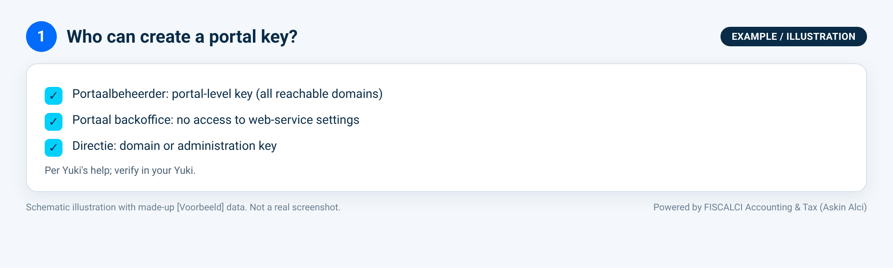
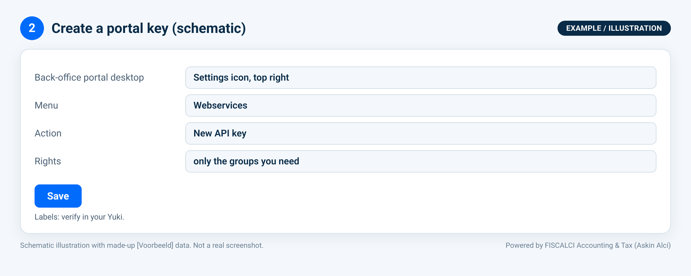
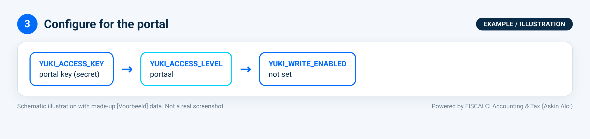
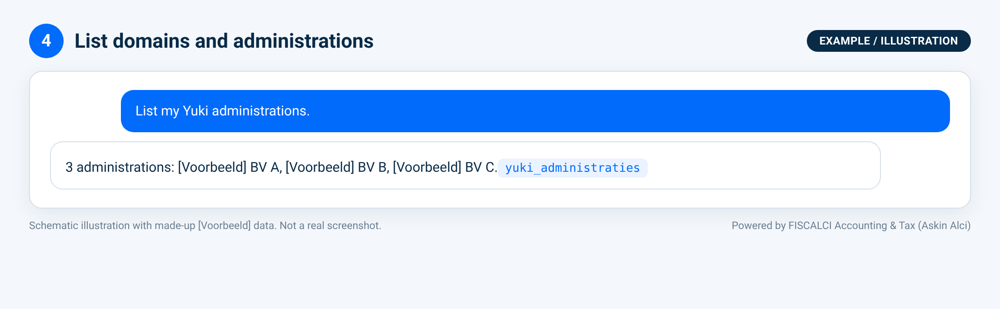
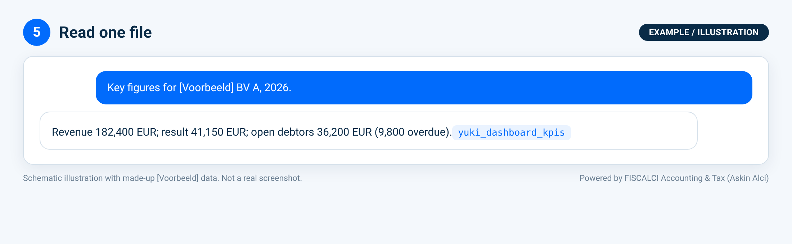
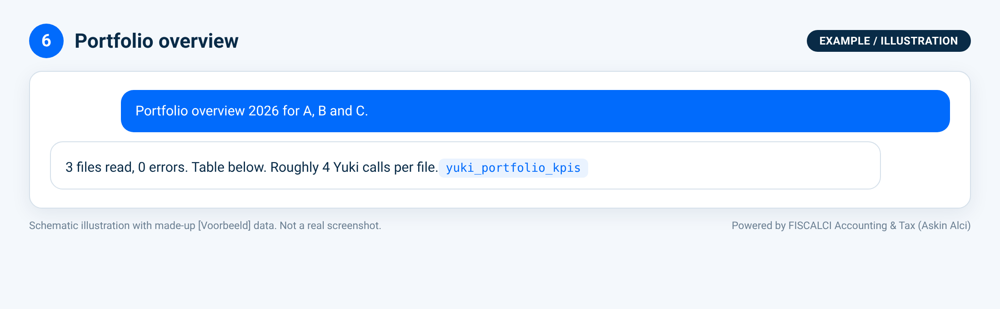
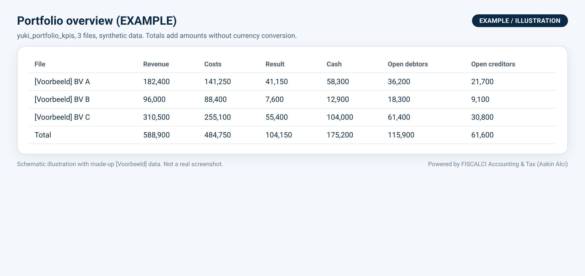
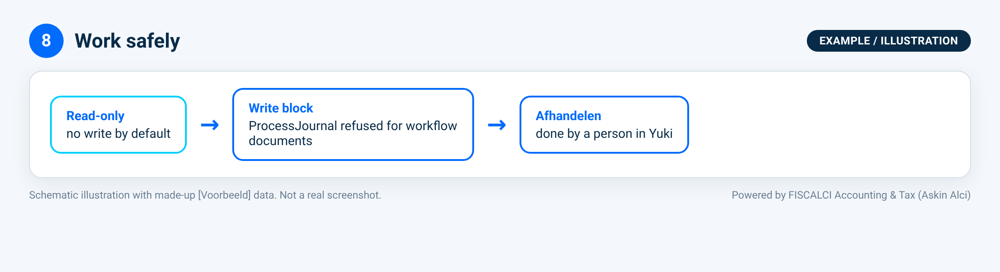
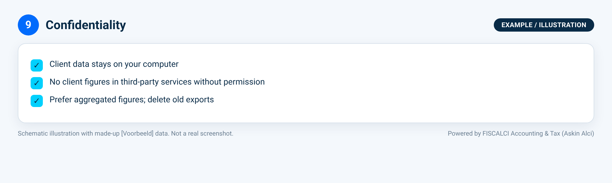

# Yuki for accountants: portal key and portfolio overview

Use a portal-level key to list domains and administrations, read one file at a time and build a multi-file overview. Read-only by default.

> **Belgium.** Made for Belgian accountants and bookkeepers: it follows the Belgian chart of accounts (MAR) and Belgian VAT. Outside Belgium, check the local rules yourself.

> **Not tax advice.** The figures are read from your Yuki administration and shown as-is. Ask your accountant before acting on them. Not approved or endorsed by Yuki or Visma.

## Step by step

### Step 1: Who can create a portal key

Only a user with the role **Portaalbeheerder** can set up web-service access at portal level; it then applies to all domains and administrations that user can reach. A 'Portaal backoffice' user cannot ([Yuki support: Webservices in portaal instellen](https://support.yuki.be/nl/support/solutions/articles/80000787839-webservices-in-portaal-instellen)). Domain or administration keys can also be made by **Directie** ([Yuki support: Webservice toegangscode](https://support.yuki.be/nl/support/solutions/articles/80000785990-webservice-toegangscode-webserviceaccesskey-)). Prefer the narrowest key that does the job.

### Step 2: Create a portal key

Per Yuki's help ([Yuki support: Webservices in portaal instellen](https://support.yuki.be/nl/support/solutions/articles/80000787839-webservices-in-portaal-instellen)): in the desktop of the back-office portal click the **Settings** icon at the top right and choose **Webservices**, then create a new API key. Select only the service groups you need. Exact labels: *verify in your Yuki*.

### Step 3: Configure the plugin for the portal

Set `YUKI_ACCESS_KEY` in Grok Bot's variables and `YUKI_ACCESS_LEVEL` to `portaal`. Leave `YUKI_WRITE_ENABLED` unset. Per-domain keys are possible with `YUKI_ACCESS_KEY_<DOMAIN>` and the `domein` parameter.

### Step 4: List domains and administrations

Ask: "List my Yuki administrations" (`yuki_administraties`). With a portal key you see every administration you can reach; pick the file you want by name or Administration ID.

### Step 5: Read one file

Ask for `yuki_dashboard_kpis` or the individual tools (`yuki_proefbalans`, `yuki_ouderdom_openstaande_posten`, ...) for one administration. Each call counts against the daily limit of that domain: check `yuki_status` first for big tasks.

### Step 6: Portfolio overview

`yuki_portfolio_kpis` reads key figures for several administrations (about 4 Yuki calls each; default at most 5, maximum 15). An error in one file does not stop the others. Totals add the amounts without currency conversion.

### Step 7: Example portfolio dashboard

The picture below is an illustration with made-up data. Your own overview contains your clients' figures: keep it on your computer.

### Step 8: Work safely

Read-only by default; the write block always refuses `ProcessJournal` for workflow documents. Workflow documents are finished in Yuki with the **Afhandelen** button (Yuki's API has no documented method for it). Your Yuki back office stays the place where bookings happen.

### Step 9: Confidentiality

Client data stays on your computer. Do not paste client figures into third-party services (AI chat, scraping, cloud BI, mail services) without the client's permission and a processing basis under the GDPR. Prefer aggregated figures, and delete exports you no longer need.

## Ready-made prompts

1. List my administrations, then run `yuki_portfolio_kpis` for 2026 for these files: <names>. Show a table with revenue, costs, result, cash and open items per file, flag files with overdue debtors above <amount>, and keep everything on this computer.
2. For <administration>, run `yuki_dashboard_kpis` and `yuki_ouderdom_openstaande_posten` and prepare a short file note for my review. Do not send anything.

## More

[Business owners](../business-owners/README.md) · [Integrations](../integrations/README.md) · [Useful apps](../integrations/APPS.md)

Powered by FISCALCI Accounting & Tax (Askin Alci)
