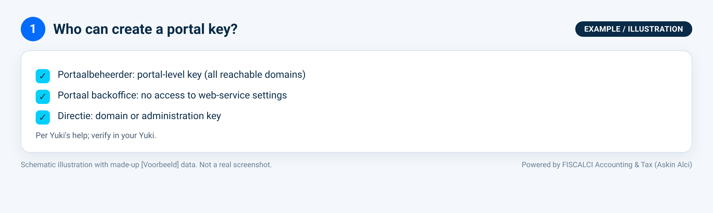
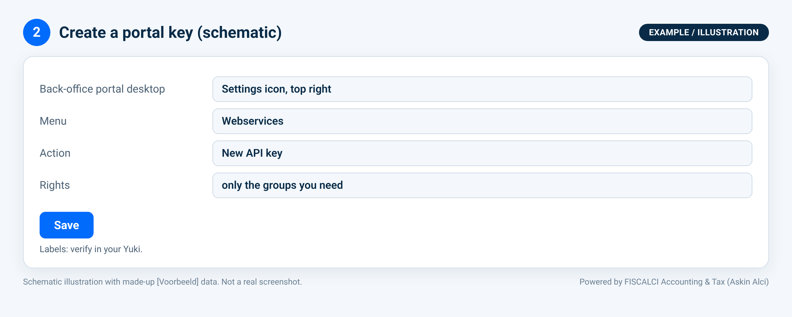
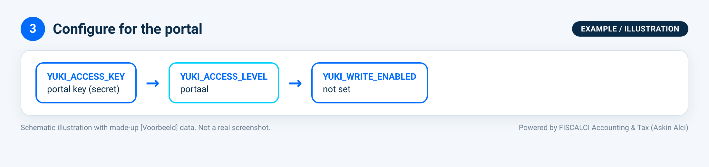
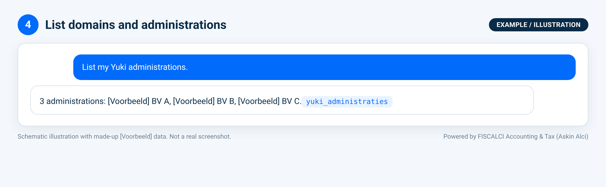
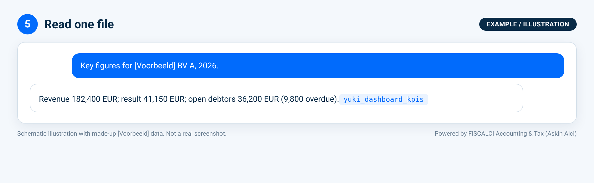
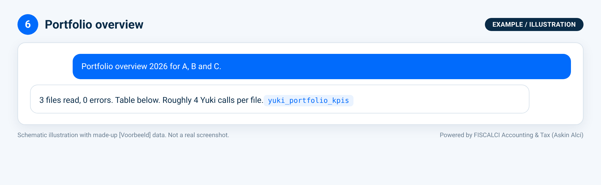
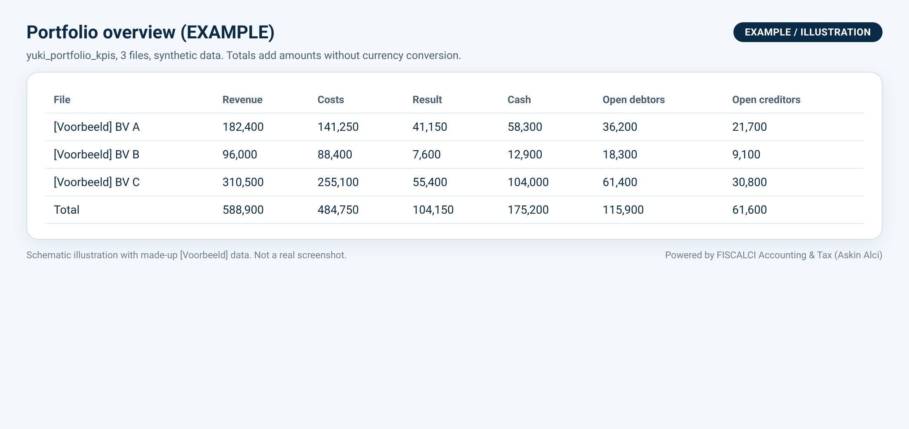
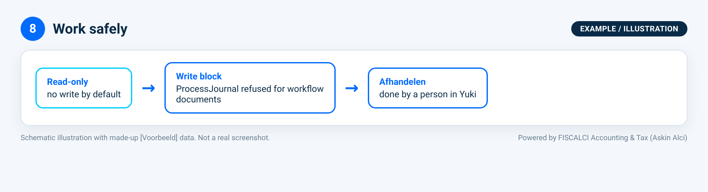
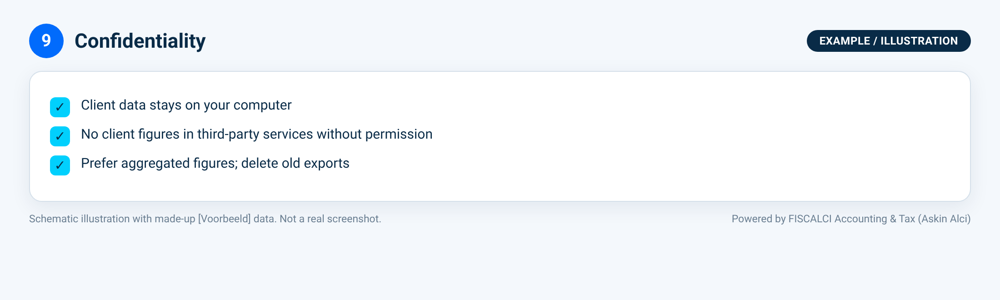

# Yuki voor accountants: portaalsleutel en portefeuilleoverzicht

Gebruik een sleutel op portaalniveau om domeinen en administraties op te lijsten, één dossier per keer te lezen en een overzicht over meerdere dossiers te bouwen. Standaard alleen-lezen.

> **België.** Bedoeld voor Belgische boekhouders/accountants; gebaseerd op Belgische boekhoud- en btw-regels (MAR, Belgisch btw-stelsel). Gebruik buiten België: verifieer zelf de lokale regels.

> **Geen fiscaal advies.** De cijfers worden uit uw Yuki-administratie gelezen en ongewijzigd getoond. Raadpleeg uw boekhouder voordat u erop handelt. Niet goedgekeurd of onderschreven door Yuki of Visma.

## Stap voor stap

### Stap 1: Wie een portaalsleutel kan maken

Enkel een gebruiker met de rol **Portaalbeheerder** kan webservicetoegang op portaalniveau instellen; die geldt dan voor alle domeinen en administraties waartoe die gebruiker toegang heeft. Een gebruiker 'Portaal backoffice' kan dat niet ([Yuki support: Webservices in portaal instellen](https://support.yuki.be/nl/support/solutions/articles/80000787839-webservices-in-portaal-instellen)). Domein- of administratiesleutels kan ook **Directie** maken ([Yuki support: Webservice toegangscode](https://support.yuki.be/nl/support/solutions/articles/80000785990-webservice-toegangscode-webserviceaccesskey-)). Kies de smalste sleutel die volstaat.

### Stap 2: Maak een portaalsleutel

Volgens de help van Yuki ([Yuki support: Webservices in portaal instellen](https://support.yuki.be/nl/support/solutions/articles/80000787839-webservices-in-portaal-instellen)): klik op de desktop van het backoffice-portaal rechtsboven op het icoon **Instellingen** en kies **Webservices**, maak daar een nieuwe API-sleutel. Selecteer enkel de nodige groepen webservices. Exacte labels: *verifieer in uw Yuki*.

### Stap 3: Stel de plugin in voor het portaal

Zet `YUKI_ACCESS_KEY` bij de variabelen van Grok Bot en `YUKI_ACCESS_LEVEL` op `portaal`. Laat `YUKI_WRITE_ENABLED` uit. Sleutels per domein kunnen met `YUKI_ACCESS_KEY_<DOMEIN>` en de parameter `domein`.

### Stap 4: Lijst domeinen en administraties

Vraag: "Toon mijn Yuki-administraties" (`yuki_administraties`). Met een portaalsleutel ziet u elke bereikbare administratie; kies het dossier op naam of Administratie-ID.

### Stap 5: Eén dossier lezen

Vraag `yuki_dashboard_kpis` of de afzonderlijke tools (`yuki_proefbalans`, `yuki_ouderdom_openstaande_posten`, ...) voor één administratie. Elke call telt mee voor de daglimiet van dat domein: controleer eerst `yuki_status` bij grote opdrachten.

### Stap 6: Portefeuilleoverzicht

`yuki_portfolio_kpis` leest kerncijfers voor meerdere administraties (ongeveer 4 Yuki-calls elk; standaard hoogstens 5, maximum 15). Een fout in één dossier stopt de rest niet. Het totaal telt bedragen op zonder valuta-omrekening.

### Stap 7: Voorbeeld portefeuilledashboard

De afbeelding hieronder is een illustratie met verzonnen data. Uw eigen overzicht bevat de cijfers van uw klanten: hou het op uw computer.

### Stap 8: Veilig werken

Standaard alleen-lezen; de schrijfblokkade weigert `ProcessJournal` altijd voor workflowdocumenten. Workflowdocumenten handelt u in Yuki af met de knop **Afhandelen** (de API van Yuki heeft daarvoor geen gedocumenteerde methode). De Yuki-backoffice blijft de plaats waar geboekt wordt.

### Stap 9: Vertrouwelijkheid

Klantgegevens blijven op uw computer. Plak geen klantcijfers in diensten van derden (AI-chat, scraping, cloud-BI, maildiensten) zonder toestemming van de klant en een verwerkingsgrondslag onder de AVG. Kies bij voorkeur geaggregeerde cijfers en verwijder exports die u niet meer nodig hebt.

## Kant-en-klare prompten

1. Toon mijn administraties en draai daarna `yuki_portfolio_kpis` voor 2026 voor deze dossiers: <namen>. Toon een tabel met omzet, kosten, resultaat, kas en openstaande posten per dossier, markeer dossiers met vervallen debiteuren boven <bedrag> en hou alles op deze computer.
2. Draai voor <administratie> `yuki_dashboard_kpis` en `yuki_ouderdom_openstaande_posten` en maak een korte dossiernota ter nazicht. Verstuur niets.

## Meer

[Ondernemers](../ondernemers/README.md) · [Integraties](../integrations/README.md) · [Nuttige apps](../integrations/APPS.md)

Powered by FISCALCI Accounting & Tax (Askin Alci)
