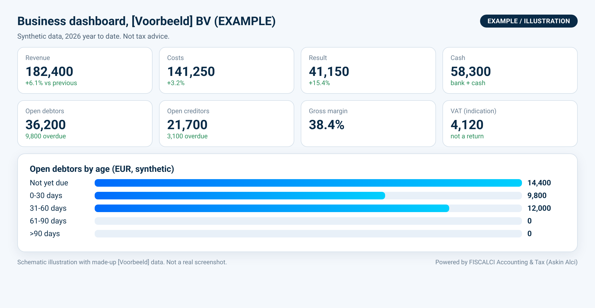
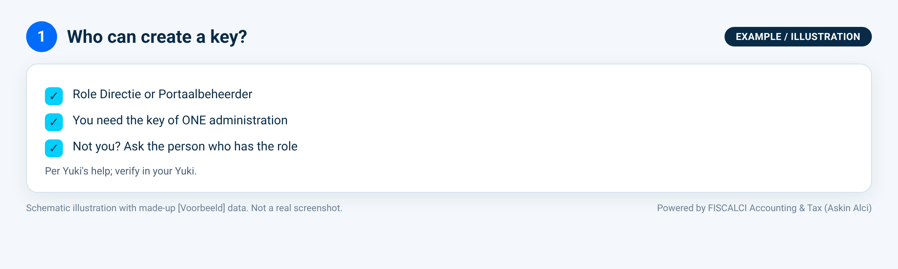
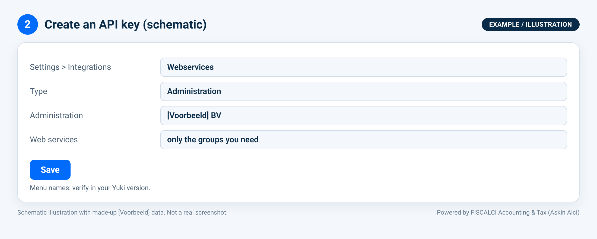
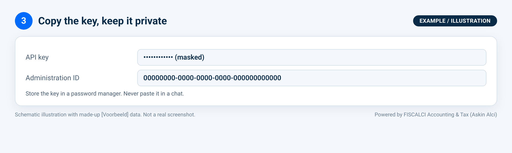
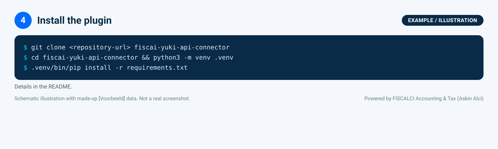
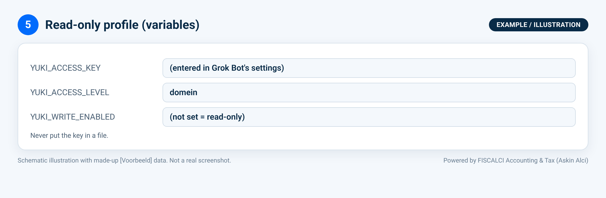
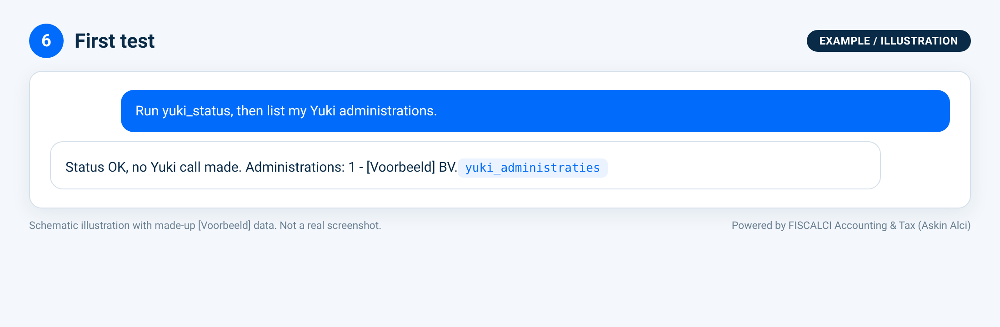
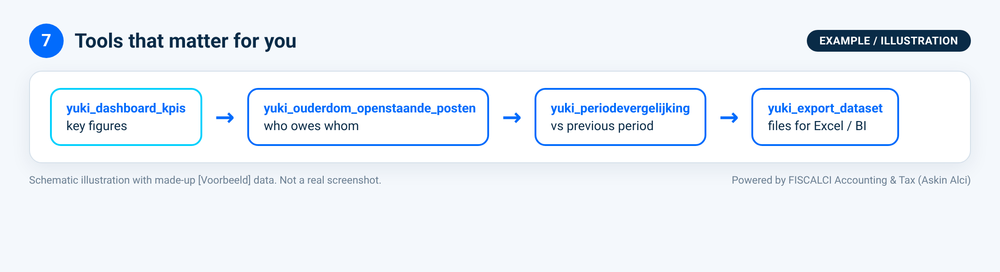
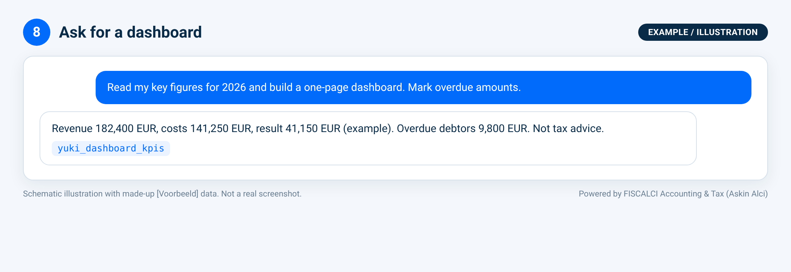

# Yuki for business owners: your own figures and dashboard

Read your own Yuki administration with Grok Bot (or another MCP client) and turn the figures into a dashboard. Read-only, on your own computer, with your own key.

> **Belgium.** Made for Belgian accountants and bookkeepers: it follows the Belgian chart of accounts (MAR) and Belgian VAT. Outside Belgium, check the local rules yourself.

> **Not tax advice.** The figures are read from your Yuki administration and shown as-is. Ask your accountant before acting on them. Not approved or endorsed by Yuki or Visma.

*EXAMPLE: made-up [Voorbeeld] data, not a real client.*

## Step by step

### Step 1: Check who may create a key

In Yuki only a user with the role **Directie** or **Portaalbeheerder** can set up web-service access for a domain or administration ([Yuki support: Webservice toegangscode](https://support.yuki.be/nl/support/solutions/articles/80000785990-webservice-toegangscode-webserviceaccesskey-)). If that is not you, ask the person who is. You need the key for **one administration** only.

### Step 2: Create an API key in Yuki

Per Yuki's help ([Yuki support: Hoe leg ik een koppeling?](https://support.yuki.be/nl/support/solutions/articles/80000787687-hoe-leg-ik-een-koppeling-)): go to **Settings > Integrations > Webservices**, click the plus icon at the top left, choose type **Administration**, select your administration, tick the web services you need and click **Save**. Yuki's rights are per service group: grant only what you need (for example the financial reports and read-only contacts). Menu names can differ per Yuki version: *verify in your Yuki*.

### Step 3: Copy the key and keep it private

After saving, Yuki shows the **API key** (WebserviceAccessKey) and the **Administration ID**. Copy the key into your password manager. Never paste it into a chat, an e-mail or a file that is shared. If it leaks, delete the key in Yuki and create a new one.

### Step 4: Install the plugin

Install FISCAi Yuki API Connector in Grok Bot as described in the [README](../../README.md#install-in-grok-bot-recommended): Python 3.10+, clone, virtual environment, `pip install -r requirements.txt`. For other clients see the [client guides](../clients/README.md).

### Step 5: Set a read-only profile

Enter `YUKI_ACCESS_KEY` in Grok Bot's variables (not in a file) and set `YUKI_ACCESS_LEVEL` to `domein`. **Do not set `YUKI_WRITE_ENABLED`**: without it nothing can be booked, uploaded or changed in Yuki. Keep the default daily limit.

### Step 6: First test

Ask: "Run `yuki_status`" (no Yuki call), then "List my Yuki administrations". You should see exactly your administration.

### Step 7: Tools that matter for you

| Question | Tool |
|---|---|
| Key figures in one go | `yuki_dashboard_kpis` |
| Revenue | `yuki_netto_omzet`, `yuki_jaartotalen` |
| Costs and margin | `yuki_marge_kostenstructuur` |
| Customers who owe you / suppliers you owe | `yuki_ouderdom_openstaande_posten`, `yuki_top_relaties` |
| Cash and liquidity | `yuki_liquiditeit`, `yuki_proefbalans` |
| VAT overview (indication only) | `yuki_dashboard_kpis` (`btw_indicatie`) |
| This period vs previous | `yuki_periodevergelijking` |
| Files for Excel or BI tools | `yuki_export_dataset` |

### Step 8: Ask for a dashboard

Paste one of the [ready-made prompts](#ready-made-prompts). Grok Bot reads the figures through the plugin and can present them as a page or canvas, or you export files for a BI tool (see [visualisation](../integrations/visualisatie/README.md)).

## Ready-made prompts

1. Read my key figures for 2026 with `yuki_dashboard_kpis` (administration: <my administration>, compare with the previous period) and build a one-page dashboard: revenue, costs, result, cash, open customers and suppliers. Mark overdue amounts. Add a line: not tax advice.
2. Show which customers owe me money and for how long (`yuki_ouderdom_openstaande_posten`, debtors) and propose a short order in which to chase them. Do not send anything.
3. Compare this quarter with the previous quarter (`yuki_periodevergelijking`) and explain in plain language what changed in revenue and costs.
4. Export my key figures and open items with `yuki_export_dataset` (csv and xlsx) to <folder> so that I can open them in Excel.

Grok Bot can present the result as a page or canvas; other clients show it as text or let you export files. Menu names differ per client: follow your client's own documentation.

## Privacy and safety

- The key stays on your computer (variables or environment), never in files, chats or screenshots.
- The plugin talks only to Yuki. The AI assistant you use sees the figures you ask for; check that assistant's privacy terms.
- Writing to Yuki stays off. Delete the key in Yuki if you stop using the plugin.

## More

[Accountants (portal)](../accountants-portal/README.md) · [Visualisation tools](../integrations/visualisatie/README.md) · [Document generation](../integrations/documenten/README.md) · [Useful apps](../integrations/APPS.md)

Powered by FISCALCI Accounting & Tax (Askin Alci)
