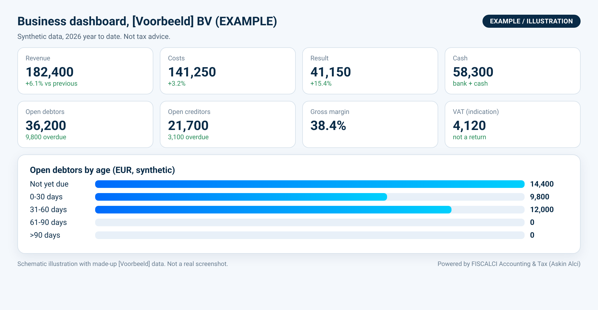
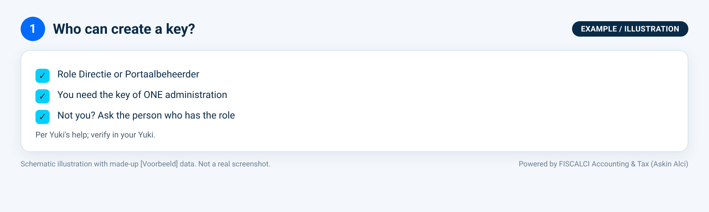
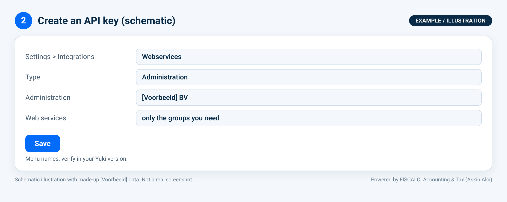
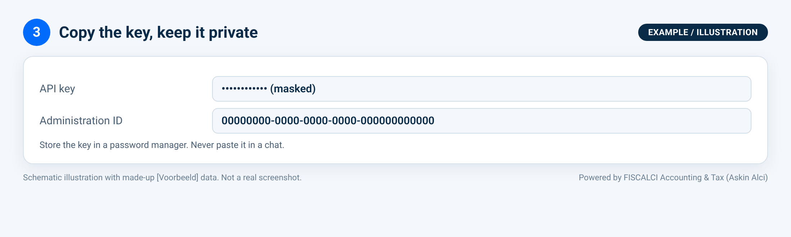
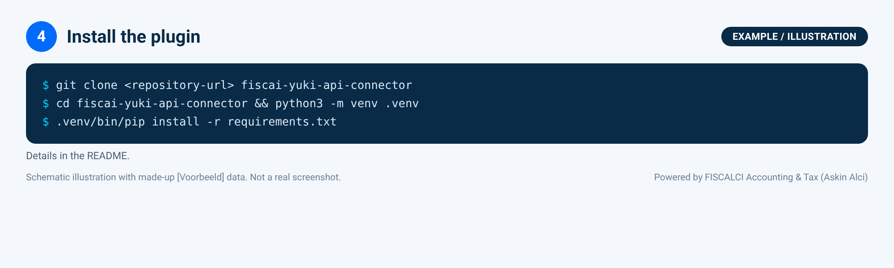
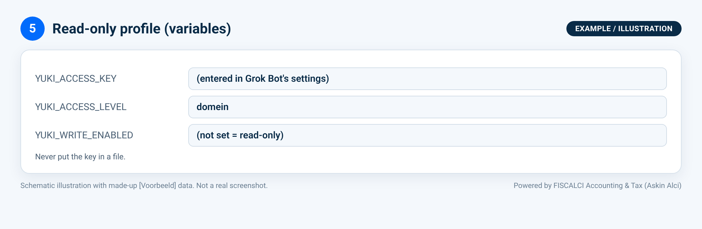
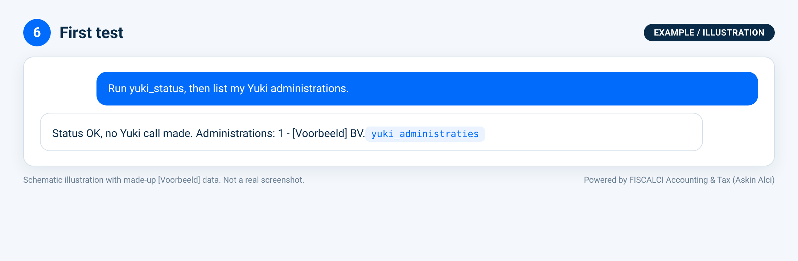
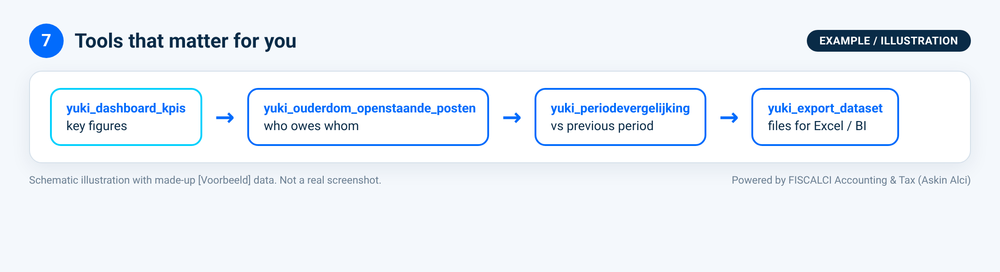
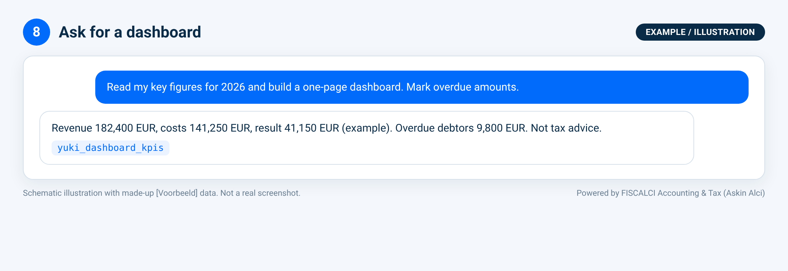

# Yuki voor ondernemers: uw eigen cijfers en dashboard

Raadpleeg uw eigen Yuki-administratie met Grok Bot (of een andere MCP-client) en maak er een dashboard van. Alleen-lezen, op uw eigen computer, met uw eigen sleutel.

> **België.** Bedoeld voor Belgische boekhouders/accountants; gebaseerd op Belgische boekhoud- en btw-regels (MAR, Belgisch btw-stelsel). Gebruik buiten België: verifieer zelf de lokale regels.

> **Geen fiscaal advies.** De cijfers worden uit uw Yuki-administratie gelezen en ongewijzigd getoond. Raadpleeg uw boekhouder voordat u erop handelt. Niet goedgekeurd of onderschreven door Yuki of Visma.

*VOORBEELD: verzonnen [Voorbeeld]-data, geen echte klant.*

## Stap voor stap

### Stap 1: Controleer wie een sleutel mag maken

In Yuki kan enkel een gebruiker met de rol **Directie** of **Portaalbeheerder** webservicetoegang instellen voor een domein of administratie ([Yuki support: Webservice toegangscode](https://support.yuki.be/nl/support/solutions/articles/80000785990-webservice-toegangscode-webserviceaccesskey-)). Bent u dat niet, vraag het dan aan wie het wel is. U hebt enkel een sleutel voor **één administratie** nodig.

### Stap 2: Maak een API-sleutel in Yuki

Volgens de help van Yuki ([Yuki support: Hoe leg ik een koppeling?](https://support.yuki.be/nl/support/solutions/articles/80000787687-hoe-leg-ik-een-koppeling-)): ga naar **Instellingen > Integraties > Webservices**, klik linksboven op het plusicoon, kies type **Administratie**, selecteer uw administratie, vink de nodige webservices aan en klik op **Bewaren**. De rechten zijn per groep webservices: geef enkel wat nodig is (bv. de financiële rapportage en contacten alleen-lezen). Menunamen kunnen per Yuki-versie verschillen: *verifieer in uw Yuki*.

### Stap 3: Kopieer de sleutel en hou hem privé

Na het bewaren toont Yuki de **API-sleutel** (WebserviceAccessKey) en de **Administratie-ID**. Kopieer de sleutel naar uw wachtwoordmanager. Plak hem nooit in een chat, e-mail of gedeeld bestand. Gelekt? Verwijder de sleutel in Yuki en maak een nieuwe.

### Stap 4: Installeer de plugin

Installeer FISCAi Yuki API Connector in Grok Bot zoals in de [README](../../README.nl.md#installatie-in-grok-bot-aanbevolen): Python 3.10+, clone, virtuele omgeving, `pip install -r requirements.txt`. Voor andere clients zie de [clientgidsen](../clients/README.md).

### Stap 5: Stel een alleen-lezenprofiel in

Vul `YUKI_ACCESS_KEY` in bij de variabelen van Grok Bot (niet in een bestand) en zet `YUKI_ACCESS_LEVEL` op `domein`. **Zet `YUKI_WRITE_ENABLED` niet aan**: zonder kan er niets geboekt, geüpload of gewijzigd worden in Yuki. Behoud de standaard daglimiet.

### Stap 6: Eerste test

Vraag: "Voer `yuki_status` uit" (geen Yuki-call), daarna "Toon mijn Yuki-administraties". U ziet precies uw administratie.

### Stap 7: Tools die voor u tellen

| Vraag | Tool |
|---|---|
| Kerncijfers in één keer | `yuki_dashboard_kpis` |
| Omzet | `yuki_netto_omzet`, `yuki_jaartotalen` |
| Kosten en marge | `yuki_marge_kostenstructuur` |
| Klanten die u nog moeten betalen / leveranciers die u nog betaalt | `yuki_ouderdom_openstaande_posten`, `yuki_top_relaties` |
| Kas en liquiditeit | `yuki_liquiditeit`, `yuki_proefbalans` |
| Btw-overzicht (enkel indicatie) | `yuki_dashboard_kpis` (`btw_indicatie`) |
| Deze periode tegenover de vorige | `yuki_periodevergelijking` |
| Bestanden voor Excel of BI-tools | `yuki_export_dataset` |

### Stap 8: Vraag om een dashboard

Plak een van de [kant-en-klare prompts](#kant-en-klare-prompts). Grok Bot leest de cijfers via de plugin en kan ze als pagina of canvas tonen, of u exporteert bestanden voor een BI-tool (zie [visualisatie](../integrations/visualisatie/README.md)).

## Kant-en-klare prompten

1. Lees mijn kerncijfers voor 2026 met `yuki_dashboard_kpis` (administratie: <mijn administratie>, vergelijk met de vorige periode) en bouw een dashboard op één pagina: omzet, kosten, resultaat, kas, openstaande klanten en leveranciers. Markeer vervallen bedragen. Voeg een regel toe: geen fiscaal advies.
2. Toon welke klanten mij nog geld verschuldigd zijn en sinds wanneer (`yuki_ouderdom_openstaande_posten`, debiteuren) en stel een korte volgorde voor om ze op te volgen. Verstuur niets.
3. Vergelijk dit kwartaal met het vorige (`yuki_periodevergelijking`) en leg in gewone taal uit wat er veranderde in omzet en kosten.
4. Exporteer mijn kerncijfers en openstaande posten met `yuki_export_dataset` (csv en xlsx) naar <map> zodat ik ze in Excel kan openen.

Grok Bot kan het resultaat als pagina of canvas tonen; andere clients tonen tekst of laten u bestanden exporteren. Menunamen verschillen per client: volg de documentatie van uw client.

## Privacy en veiligheid

- De sleutel blijft op uw computer (variabelen of omgeving), nooit in bestanden, chats of schermafbeeldingen.
- De plugin praat enkel met Yuki. De AI-assistent die u gebruikt ziet de cijfers die u opvraagt; controleer de privacyvoorwaarden van die assistent.
- Schrijven naar Yuki blijft uit. Verwijder de sleutel in Yuki als u de plugin niet meer gebruikt.

## Meer

[Accountants (portaal)](../accountants/README.md) · [Visualisatietools](../integrations/visualisatie/README.md) · [Documentgeneratie](../integrations/documenten/README.md) · [Nuttige apps](../integrations/APPS.md)

Powered by FISCALCI Accounting & Tax (Askin Alci)
